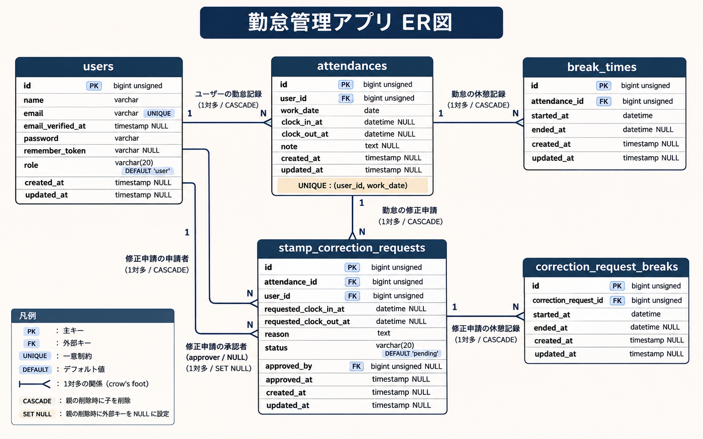

# 勤怠管理アプリケーション

Laravel 10を使用した勤怠管理アプリケーションです。

一般ユーザーの勤怠登録・修正申請、管理者による勤怠管理・修正承認などを実装しています。

## 使用技術

- PHP 8.2
- Laravel 10
- Laravel Fortify
- MySQL 8.4
- Laravel Sail / Docker
- Blade / CSS / Vite
- PHPUnit
- Laravel Pint

## 主な機能

### 一般ユーザー

- 会員登録・ログイン・ログアウト
- メール認証
- 出勤・退勤打刻
- 休憩開始・終了（複数回対応）
- 月別勤怠一覧
- 勤怠詳細表示
- 勤怠修正申請
- 修正申請一覧（承認待ち・承認済み）
- マイ勤怠レポート（過去6か月の労働時間・残業時間・月次推移・異常検知）

### 管理者

- 管理者ログイン
- 日別勤怠一覧
- 勤怠詳細・直接修正
- スタッフ一覧
- スタッフ別月間勤怠一覧
- 修正申請一覧・詳細
- 勤怠修正申請の承認
- スタッフ別月間勤怠一覧のCSV出力

### CSV出力機能（応用機能 FN045）

管理者はスタッフ別の月間勤怠一覧から、CSVファイルをダウンロードできます。

操作手順：

1. 管理者としてログインする
2. 「スタッフ一覧」を開く
3. 対象スタッフの勤怠一覧を表示する
4. 必要に応じて前月・翌月へ移動する
5. 「CSV出力」をクリックする

出力項目：

- 日付
- 出勤時刻
- 退勤時刻
- 休憩時間
- 合計勤務時間

ファイル名：`attendance_staff_{スタッフID}_{YYYY-MM}.csv`

文字コード：UTF-8（BOM付き）

CSVには選択したスタッフ・対象月の勤怠情報のみ出力されます。
勤怠データがない場合は、ヘッダー行のみのCSVを出力します。

CSV出力は管理者専用機能です。

### マイ勤怠レポート（応用機能）

一般ユーザーは `/attendance/report` で、自分の勤怠統計を確認できます。

表示内容：

- 過去6か月（当月を含む）の総労働時間
- 1日8時間を超えた総残業時間
- 勤務完了日あたりの平均労働時間
- 過去6か月の月次推移
- 当月の遅刻・早退・長時間労働の回数

労働時間は休憩時間を差し引いて計算します。

異常検知の判定基準：
- 遅刻：日本時間9:00を超える出勤
- 早退：日本時間18:00より前の退勤
- 長時間労働：実働時間10時間超

未完了の勤怠は労働時間・残業時間の集計対象外です。
月次推移では、記録のない月は0として表示します。

一般ユーザー本人の勤怠情報のみを対象とし、
未ログインユーザーや管理者はアクセスできません。

### 公開勤怠API v1（応用機能 FN057〜FN068）

勤怠情報をJSON形式で取得・登録・更新・削除するAPIです。

| HTTP | URL | 認証 |
|---|---|---|
| GET | `/api/v1/attendance-records` | 不要 |
| GET | `/api/v1/attendance-records/{attendanceRecord}` | 不要 |
| POST | `/api/v1/attendance-records` | Sanctum |
| PUT | `/api/v1/attendance-records/{attendanceRecord}` | Sanctum |
| PATCH | `/api/v1/attendance-records/{attendanceRecord}` | Sanctum |
| DELETE | `/api/v1/attendance-records/{attendanceRecord}` | Sanctum |

一覧取得では次の絞り込みに対応しています。

- `user_id`：ユーザーID
- `date`：勤務日（YYYY-MM-DD）
- `month`：対象月（YYYY-MM）
- `page`：ページ番号
- `per_page`：1ページあたりの件数（既定20、最大100）

書き込みAPIでは認証が必要です。
更新・削除は本人または管理者のみ実行できます。

主なHTTPステータスコード：

- 200：取得・更新成功
- 201：新規登録成功
- 204：削除成功
- 401：未認証
- 403：操作権限なし
- 404：対象データなし
- 422：入力検証エラー

日時はUTCで保存し、日本時間で入出力します。

#### 既知の制限事項

- 夜勤の翌日退勤時刻をAPI入力から新たに指定する機能は未対応です。
- 出退勤時刻を変更した場合、既存休憩が新しい勤務時間内に収まるかの検証は未対応です。
- 勤務日変更では関連する修正申請の日時も移動します。承認済み申請を含む業務上の取り扱いには追加確認が必要です。
- GET APIは仕様に従って認証不要です。個人の勤怠情報を返すため、実データを含む環境を外部公開しないでください。

## 環境構築

### 必要な環境

- Docker Desktop
- Docker Compose
- Git
- Composer
- Node.js / npm

Windowsの場合はWSL2上での実行を想定しています。

### Composerについて

このREADMEでは、WSL2またはホスト環境にPHPとComposerが
インストールされていることを前提としています。

`composer install` はLaravel Sail起動前に実行してください。

初回セットアップでは、PHPとComposerの対応バージョン、
必要なPHP拡張機能がインストールされていることを確認してください。

Laravel Sailの起動後は、Artisanやnpmなどのコマンドを
`./vendor/bin/sail` 経由で実行します。

### 1. リポジトリを取得

```bash
git clone git@github.com:yo-hiraoka/attendance-app.git
cd attendance-app
```

HTTPSで取得する場合は、次のURLも利用できます。

```text
https://github.com/yo-hiraoka/attendance-app.git
```

### 2. PHP依存パッケージをインストール

```bash
composer install
```

### 3. 環境変数を設定

```bash
cp .env.example .env
```

`.env` のMySQL接続情報が以下になっていることを確認してください。

```dotenv
DB_CONNECTION=mysql
DB_HOST=mysql
DB_PORT=3306
DB_DATABASE=attendance_app
DB_USERNAME=sail
DB_PASSWORD=password
```

※ `.env` はGitHubにコミットしないでください。

### 4. Dockerコンテナを起動

```bash
./vendor/bin/sail up -d
```

### 5. アプリケーションキーを生成

```bash
./vendor/bin/sail artisan key:generate
```

### 6. データベースを作成

```bash
./vendor/bin/sail artisan migrate
```

### 7. フロントエンドの準備

```bash
./vendor/bin/sail npm install
./vendor/bin/sail npm run build
```

開発中にCSS等の変更を自動反映する場合：

```bash
./vendor/bin/sail npm run dev
```
### 8. ER図



### 9. ブラウザでアクセス

| サービス | URL |
|---|---|
| アプリケーション | http://localhost |
| 一般ユーザーログイン | http://localhost/login |
| 会員登録 | http://localhost/register |
| 管理者ログイン | http://localhost/admin/login |
| Mailpit | http://localhost:8025 |
| phpMyAdmin | http://localhost:8080 |

※ 使用ポートは `.env` の設定により変更できます。

## デモデータ（任意）

動作確認用のデータを投入する場合：

```bash
./vendor/bin/sail artisan db:seed --class=AttendanceDemoSeeder
```

### デモアカウント

`AttendanceDemoSeeder` を実行すると、以下のアカウントが作成されます。

| 種類 | メールアドレス | パスワード |
|---|---|---|
| 一般ユーザー1 | demo-user1@example.com | password |
| 一般ユーザー2 | demo-user2@example.com | password |
| 管理者 | demo-admin@example.com | password |

一般ユーザーは `/login`、管理者は `/admin/login` からログインしてください。

デモアカウントはメール認証済みで作成されます。

**注意：**
- これらのアカウントは開発・動作確認専用です。
- 本番環境では使用しないでください。
- 同じメールアドレスのデモユーザーが存在する場合、Seederはデータ投入を中止します。
- デモデータは自動投入されません。必要な場合のみSeederを実行してください。

デモユーザー・管理者のアカウント、勤怠記録、修正申請などが作成されます。

※ デモデータ投入は必須ではありません。既存データのある環境では実行前に内容を確認してください。

## テスト

### PHPUnit

```bash
./vendor/bin/sail artisan test
```

### Laravel Pint

```bash
./vendor/bin/sail pint --test
```

### コード差分チェック

```bash
git diff --check
```

開発時の確認実績（Issue #43完了時）：

- PHPUnit：179件PASS（638 assertions）
- API専用テスト：29件PASS（112 assertions）
- Laravel Pint：112ファイルPASS

## データベース設計

主な業務テーブルは以下の5テーブルです。

1. `users`
2. `attendances`
3. `break_times`
4. `stamp_correction_requests`
5. `correction_request_breaks`

Laravel標準の管理用テーブルも使用しています。

詳しい設計方針は [データベース設計方針](docs/database-design.md) を参照してください。

## 補足事項

- 日時は原則UTCで保存し、表示時に日本時間へ変換します。
- 勤怠修正申請は管理者の承認後に勤怠記録へ反映されます。
- 管理者アカウントは一般ユーザーの会員登録画面から作成できません。
- 本番環境に公開する場合は、依存パッケージのセキュリティ確認と環境設定の見直しが必要です。

## セキュリティ・運用上の注意

2026年11月14日時点のローカル監査結果：

- Laravel Framework：10.50.4
- Composer：laravel/framework に関するセキュリティ勧告5件
  - Low：2件
  - Medium：1件
  - High：1件
  - 深刻度未記載：1件
- npm audit --omit=dev：脆弱性0件

Composerの5件には、同一のGitHub Advisoryを参照する
重複した勧告が含まれています。

Laravel 10は公式セキュリティサポートが終了しています。

本プロジェクトは学習課題としてLaravel 10を使用しており、
今回の作業では依存パッケージを更新していません。

実データを扱う本番環境への公開前には、以下の対応が必要です。

- サポート対象のLaravelへのアップグレード
- Composerとnpmのセキュリティ監査
- 全機能の回帰テスト
- APIの認証・公開範囲の見直し
- 本番環境の設定と秘密情報の保護
